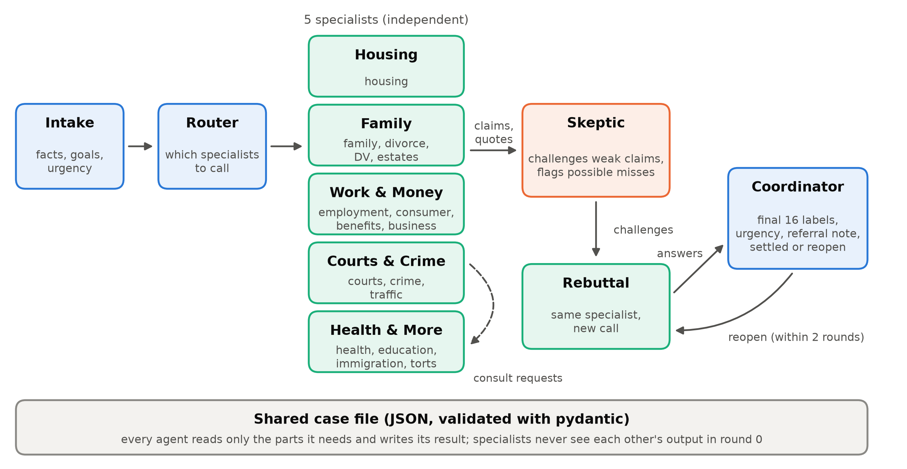
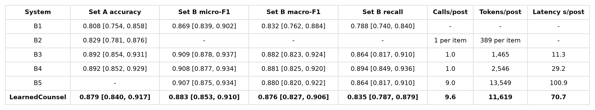
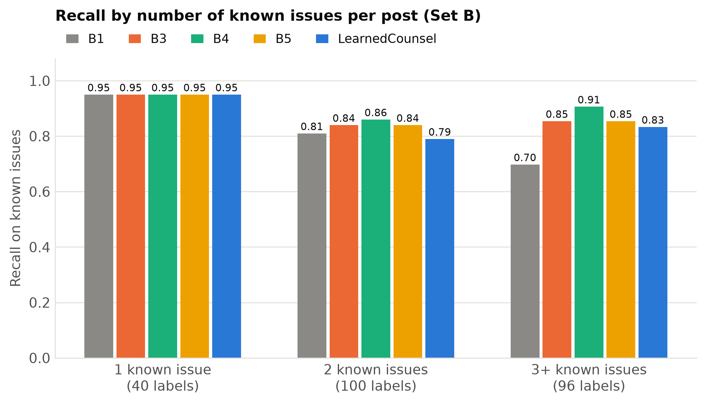
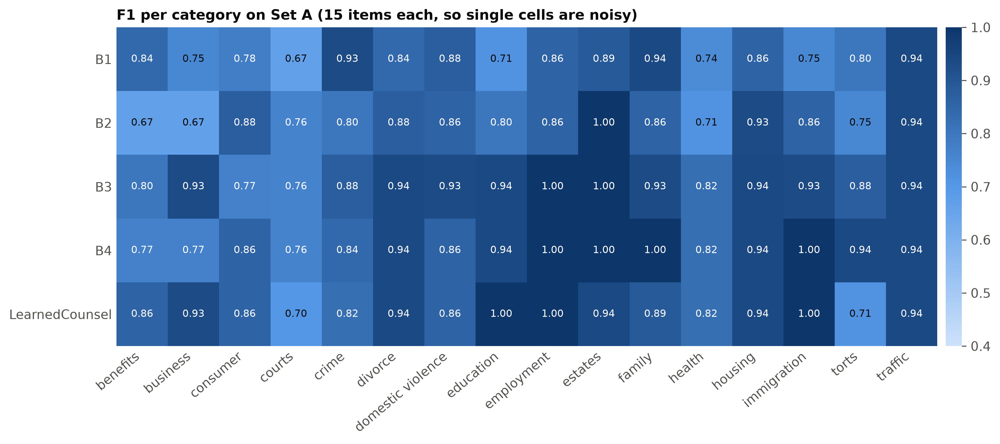
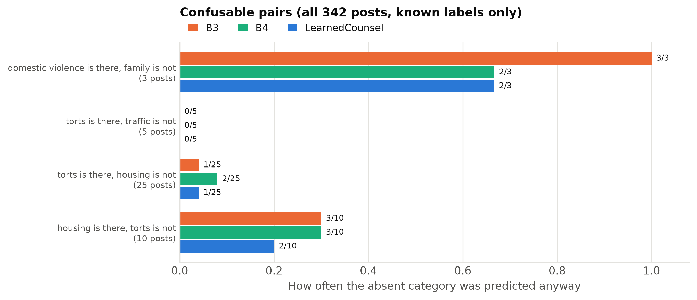
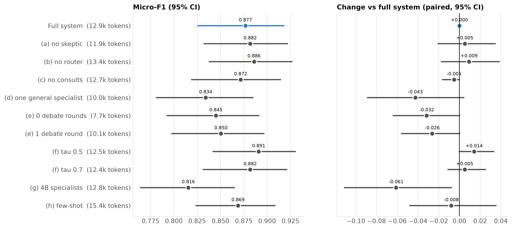
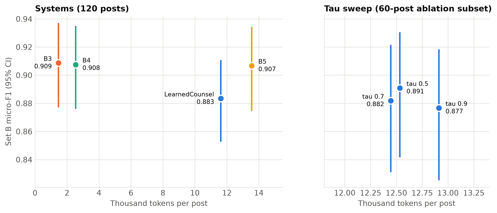
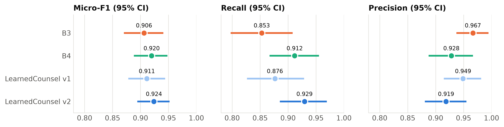
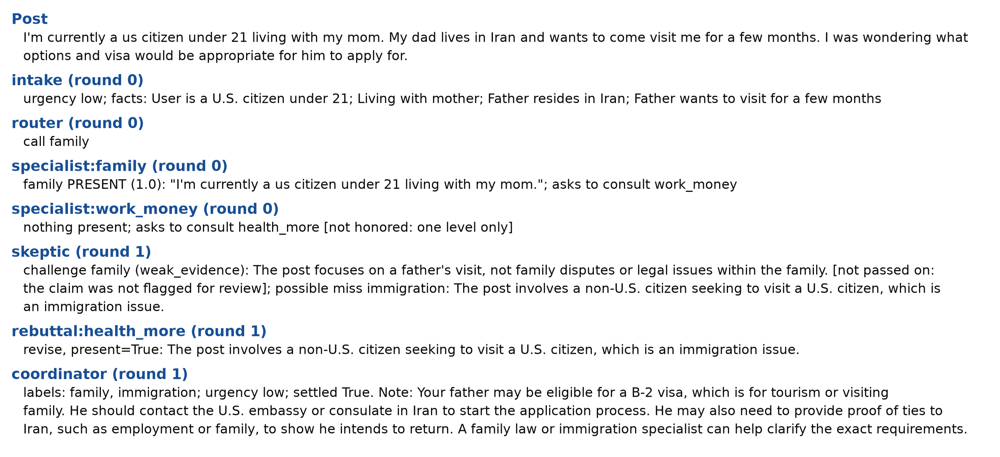

# LearnedCounsel: Multi-Agent Legal Issue Spotting for Access to Justice

**Team leader:** Siddharth Pendyala. **Team member:** Palash Doshi. CMPSC 448, Penn State, Fall 2026.

*Draft. Every number comes from a saved run in `results/`. References are numbered as in `report/REFERENCES.md`.*

## Summary
We built a team of AI agents that reads a person's story and finds which of 16 legal issue categories it involves, with quoted evidence. All agents use one free 8B model on one laptop. We compared the team with five baselines, four of them single-model setups of the same model. **The team did not beat a single call**: micro-F1 0.883 against 0.909 on 120 posts (difference −0.025, 95% CI [−0.052, +0.000]), at about 8 times the tokens. Ablations showed why: a router left out needed specialists, and the skeptic's challenges did not help. A second version designed from these findings, tested once on 90 fresh posts, reached recall 0.929 against 0.853 for the single call (difference +0.076 [+0.036, +0.117]), but lost precision (−0.048 [−0.079, −0.020]), and its F1 advantage of +0.018 [−0.007, +0.045] is not significant. A single prompt that runs the same steps matched it at a sixth of the tokens. What the agents clearly do better is evidence: 95% of their quotes are really in the post, against 62% for that prompt.

## 1. Problem, and why multiple agents

### 1.1 The problem
Low-income Americans get no or not enough legal help for 92% of the civil legal problems that substantially affect them [4]. One bottleneck is **issue spotting**: people tell stories ("my landlord kept my deposit and now my boss might fire me"), but legal help is organized by category. A story often contains several issues, and the person may not know any of their names. LearnedCounsel outputs the categories with quoted evidence, an urgency level and a short referral note. It does not give legal advice.

### 1.2 Why local models
These stories can contain immigration status, abuse, debts and health details. A system that runs on one laptop with an open model can be used at no cost and without sending the stories to a third party. This sharpens the research question: **can collaboration make a small local model good enough?**

### 1.3 Why multiple agents might help
1. **Specialization:** a specialist sees only its own definitions and judges a few categories.
2. **Adversarial checking:** a skeptic looks for weak claims and missed issues.
3. **Dynamic coordination:** specialists pull in other specialists, and the coordinator reopens questions and decides when to stop.
4. **Verifiable evidence:** code checks each quote against the post, and the agent is asked again when it fails.

Reasons for doubt were known before we started. Steging et al. [5] report that multi-agent frameworks "achieve comparable overall performance to baseline large language models" while they "produce significantly distinct answers". We therefore measured instead of assuming.

**Research question.** Does multi-agent collaboration beat strong single-model baselines using the same small model, especially on recall for posts with several issues, and at what cost?

## 2. Design and implementation

### 2.1 Agents and the shared case file

*Figure 1. Architecture (v1).*

| Agent | Sees | Produces |
|---|---|---|
| Intake | the post | facts, parties, state, timeline, goals, urgency |
| Router | post, intake notes, all definitions | which specialists to call |
| 5 specialists | post, intake notes, **own definitions only** | per category: quote, rationale, present, confidence; consult requests |
| Skeptic | post, all claims, all definitions | challenges, possible misses |
| Rebuttal (same specialist, new call) | post, its own claim, the question | maintain, withdraw or revise |
| Coordinator | post, intake, claims, debate | 16 labels, urgency, referral note, settled or reopen |

Agents communicate only through a **case file** validated with pydantic. Specialists never see each other's output in round 0. The specialists cover Housing; Family (family, divorce, domestic violence, estates); Work & Money (employment, consumer, benefits, business); Courts & Crime (courts, crime, traffic); Health & More (health, education, immigration, torts).

### 2.2 Coordination and disagreement
- **Consults:** a specialist can request one the router skipped (one level deep).
- **Challenges:** the skeptic may challenge a positive claim only if its confidence is below τ or its quote is not in the post. The rule is enforced in code, so τ has a measurable effect.
- **Possible misses:** the skeptic may flag any absent category.
- **Reopening:** if the coordinator is not settled, it sends up to 3 questions back to specialists, within MAX_ROUNDS = 2.

### 2.3 Implementation
Python 3.11, Ollama 0.40.17, `qwen3:8b` [6] (8.2B parameters, 4-bit Q4_K_M, thinking off, context 8,192, temperature 0), on an NVIDIA RTX 4070 Laptop GPU (8 GB), AMD Ryzen 7 8845HS and 32 GB RAM. The model runs 100% on the GPU. Key parts:
- **Structured outputs:** a JSON schema for every call, pydantic validation, one repair retry. In the main run, 3 of 3,292 calls needed a repair and 1 stayed invalid (a runaway intake reply); in that case the system used default intake notes.
- **Evidence check:** quotes must appear in the post (ignoring case, punctuation, whitespace, HTML entities). One re-prompt raised validity from 80.3% of specialists' first answers to 95.4% of final positive labels.
- **Disk cache** keyed by model, messages, schema, temperature and sample: interrupted runs resume, and ablations reuse unchanged calls.
- **Runtime budget** across all runs, a context-length check before and after every call, and transcripts of every message.
- **Tests:** 40 unit tests run with a fake model, without Ollama.

### 2.4 Version 2
After the first evaluation we changed four things (Section 3.6): no router; a **Scout** that reads all 16 categories independently, whose disagreements with the specialists become questions; a skeptic that raises possible misses only; a stricter rule for the referral note.

## 3. Evaluation

### 3.1 Data
We use the 16 `learned_hands_*` tasks of LegalBench [1], built from Learned Hands [2], whose labels follow the LIST taxonomy [3]: Reddit legal questions labeled by people with legal expertise. Each task is a balanced Yes/No question whose negatives were randomly sampled from other topics. We read the files at a pinned commit (details in `data/DATA_CARD.md`): 11,109 test rows, 5,299 unique posts.
- **Set A:** 15 items per category, 240 items, 230 posts.
- **Set B:** one row per post with 16 labels: positive, negative or **masked** (the post never appears in that task). 488 posts have 2+ known positives. Sample: 120 posts (40 / 50 / 30 with 1 / 2 / 3+ known positives), 368 known labels.
- **Ablation subset:** 60 posts of that sample. **Dev:** 20 posts for tuning, never evaluated.
- **v2:** 24 new dev posts and 90 fresh test posts (30 / 42 / 18; 262 known labels), disjoint from all others.

Category definitions come from the official LegalBench task descriptions and are the same for every system.

### 3.2 Baselines
| | System | Calls/post |
|---|---|---|
| B1 | TF-IDF + logistic regression per category, 5-fold CV grouped by post. **Supervised** on about 80% of each task's data | – |
| B2 | One zero-shot Yes/No call per item (Set A only) | 1 per item |
| B3 | One call, all 16 labels and evidence | 1 |
| B4 | One call running the same workflow in one prompt | 1 |
| B5 | Majority vote over 9 samples of B3 at temperature 0.7 [7], k matched to LearnedCounsel's tokens on dev posts | 9 |

Published LegalBench scores come from other, mostly larger models, so our absolute numbers cannot be compared with them. All our comparisons use the same local model.

### 3.3 Metrics and statistics
Set A: accuracy per category, averaged. Set B: micro and macro F1, precision, recall and exact match on known labels, and recall by number of known positives. Cost: calls, tokens, latency. 95% intervals: 1,000 bootstrap resamples of posts. Set A comparisons: exact McNemar with Holm correction. Set B comparisons: paired bootstrap differences, **not** corrected for multiple comparisons. τ = 0.9, the B3 variant and k were chosen on the 20 dev posts.

### 3.4 Main results

*Table 1. All systems. Latency: 5 dev posts, one request at a time, no cache. Cost: averages over all posts a system ran (342, or 120 for B5).*

*Figure 2. Recall by number of known issues.*

| LearnedCounsel minus | micro-F1 (Set B) | recall (Set B) | Set A: only we / only they right | McNemar p (Holm) |
|---|---|---|---|---|
| B1 | +0.014 [−0.024, +0.052] | +0.047 [−0.009, +0.104] | 36 / 19 | 0.030 (0.120) |
| B2 | – | – | 26 / 14 | 0.081 (0.242) |
| B3 | −0.025 [−0.052, +0.000] | −0.030 [−0.071, +0.013] | 8 / 11 | 0.648 (1.000) |
| B4 | −0.024 [−0.050, −0.000] | **−0.059 [−0.098, −0.021]** | 7 / 10 | 0.629 (1.000) |
| B5 | −0.023 [−0.049, +0.003] | −0.030 [−0.071, +0.013] | not run on Set A | – |

1. **No baseline that covers all 16 labels was beaten significantly, and B4 finds more issues.** Our hypothesis about recall on multi-issue posts is not supported: for 3+ issues, recall is 0.833 (LearnedCounsel), 0.854 (B3), 0.906 (B4).
2. **Cost:** 11,619 tokens and 70.7 s per post, against 1,465 tokens and 11.3 s for B3.
3. **Voting adds nothing:** B5 differs from B3 on 10 of 1,920 labels. At temperature 0.7 the model gives nearly the same answer every time.
4. **Evidence is the strength:** 95.4% of LearnedCounsel's quotes are verbatim, 92.0% for B3 and 60.6% for B4 (all 342 posts).

*Figure 3. F1 per category on Set A (15 items per cell).*

*Figure 4. Confusable pairs. Only pairs with at least 3 posts whose labels are known for both categories; counts are small.*

### 3.5 Why: ablations and the debate

*Figure 5. Ablations on 60 posts, 10 comparisons, not corrected.*

*Figure 6. Quality vs cost, and the τ sweep.*

- **Router (b):** calling all five specialists raises recall by 0.043 [+0.000, +0.087] and lowers precision by 0.031. On the 120 posts, LearnedCounsel missed 39 known issues: 17 where the specialist looked and said absent, 15 where it was never called, 7 found first and lost in the debate.
- **Specialization (d):** one general specialist is lower by 0.043 [−0.089, +0.004]; not significant.
- **Debate (e):** without it recall drops by 0.051 [−0.098, −0.008]. On these 60 posts the first pass scores F1 0.844 and the debate lifts it to 0.877, mainly through the coordinator's questions.
- **Skeptic (a):** removing it changes F1 by +0.005 [−0.021, +0.034]. Over all 342 posts, 34 of 166 challenges flipped a label; 5 of these labels are known and all 5 flips were wrong. Possible misses were accepted 53 of 68 times, and 18 of the 20 with a known label were right.
- **τ (f):** 0.5, 0.7, 0.9 give F1 0.891, 0.882, 0.877. We keep the pre-selected 0.9.
- **4B specialists (g):** F1 −0.061 [−0.111, −0.008], recall −0.103 [−0.176, −0.018]. **Few-shot (h):** −0.008 [−0.048, +0.035].
- **Different mistakes:** on these 60 already scored posts, the union of LearnedCounsel and B3 would reach F1 0.922. This is a diagnosis, not a result, and it motivated v2.

### 3.6 Optimization: v2 on fresh posts
The design, three candidates, the selection rule and the primary comparison were written down **before** any v2 run. The candidate `v2_both` was best on 24 new dev posts and was then run **once** on 90 fresh posts. v2's design came from looking at the first evaluation, so only the fresh test supports it.

*Figure 7. Fresh test, 90 posts.*

| System | micro-F1 | Precision | Recall | Recall 3+ | Labels/post | Wrong on 92 known negatives | Verbatim quotes | Tokens/post |
|---|---|---|---|---|---|---|---|---|
| B3 | 0.906 | 0.967 | 0.853 | 0.768 | 2.67 | 5 | 90.8% | 1,449 |
| B4 | 0.920 | 0.928 | 0.912 | 0.875 | 3.42 | 12 | 62.0% | 2,528 |
| LearnedCounsel v1 | 0.911 | 0.949 | 0.876 | 0.804 | 2.96 | 8 | 95.8% | 11,959 |
| LearnedCounsel v2 | 0.924 | 0.919 | 0.929 | 0.911 | 3.42 | 14 | 94.8% | 15,279 |

- **Primary: v2 vs B3 micro-F1 +0.018 [−0.007, +0.045]: not significant.** McNemar p = 0.54.
- **Recall +0.076 [+0.036, +0.117], precision −0.048 [−0.079, −0.020].** v2 outputs 28% more labels than B3 and marks 14 of 92 known negatives instead of 5. The known labels are 170 positives and 92 negatives, so F1 here favors generous systems.
- **v2 vs B4:** F1 +0.004 [−0.017, +0.027], at 6 times the tokens. Verbatim quotes: +0.328 [+0.250, +0.406].
- **v2 vs v1:** recall +0.053 [+0.012, +0.091], precision −0.030 [−0.061, −0.001].
- **v1 vs B3 changes sign** between the samples (−0.025, then +0.005 [−0.025, +0.034]): they are not distinguishable.

### 3.7 Case studies
Found with fixed filters on the first evaluation (agreement with the label, then shortest posts). Post ids refer to `logs/transcripts/learnedcounsel_main/`.

1. **Win, specialist focus (94c35b).** A future server asks how "paying child and tips works". LearnedCounsel labels *family*; B3 and B4 miss it. The specialist kept its claim (0.8) when the skeptic challenged it.
2. **Win, staying narrow (2c5645).** An ex broke a woman's arm and changed the locks. B3 and B4 add *housing*; the housing specialist says this is domestic violence, matching the label.
3. **Win, skeptic's possible miss (47e427, Figure 8).** The router calls only Family for a visa question. A consult request for Health & More is ignored (one level only), but the skeptic flags *immigration* and it is added. The referral note then suggests a visa type, which is legal advice (Section 5).
4. **Skeptic-caused error (9061b8).** A homeowner asks about selling as-is. The Housing specialist was right (0.8) but gave no quote; the skeptic said the post is about a neighbor, and the specialist withdrew. B3 and B4 were right.
5. **Skeptic-caused error (dcae95).** A person accused of cyberstalking an ex asks about a restraining order. *domestic_violence* is a known positive; the challenge made the specialist withdraw it. The specialist's own quote ("I'm in no accusation of domestic violence") was weak.
6. **Missed issue (de58a1).** A DUI question: the Courts & Crime specialist's first pass finds only *courts*; *crime* is added later, but a coordinator question about *traffic* does not change its mind. B3 and B4 find all three.
7. **Missed issue (314c2c).** A patient held down during dental surgery asks about an online review. The specialist says no harm is claimed; B3 and B4 find *torts*.
8. **Shared error (0ca163).** A missed loan payment to an ex-wife. All three systems say *consumer* and miss *divorce*, which needs an inference from "contempt of court".
9. **Doubtful label (8099eb).** A post about a rape victim in Ohio is labeled *divorce*; no system says so, and the text does not mention a marriage. Some errors are label noise.

*Figure 8. One full transcript.*

## 4. Lessons learned
1. **Schemas shape behavior.** With an open-ended list the 8B model kept adding items up to the token cap (about 1,362 output tokens, 6 of 16 calls repaired). One fixed field per category gave 188 tokens and no repairs.
2. **Definitions matter.** Our own category definitions disagreed with the official ones in several places (traffic includes car repairs, courts includes hiring lawyers). We rewrote them from the task descriptions.
3. **A prompt is not a constraint.** "No legal advice" and "favor recall" were often ignored; rules that matter belong in code, as we did for τ and quotes.
4. **Confidence from a small model is coarse.** Positive claims got almost only 0.8 or 1.0, so τ = 0.7 and below hardly ever lets a low-confidence challenge through.
5. **Agreeing can be right or wrong.** Specialists accepted most "possible misses", mostly correctly. Challenges that changed labels did harm where we could check.
6. **A router saves calls and loses recall.** The agents that were never asked could not disagree.
7. **Choosing parameters on 20 posts is fragile.** τ = 0.9 won there by one label and was the worst of three on the ablation subset.
8. **Strong baselines change the story.** With only B2 we might have claimed a gain. B3 and B4 showed there was none.
9. **Look at what the systems output, not only at F1.** v2's recall gain looked like a win until we counted labels per post.
10. **Our own analysis needed auditing.** We once explained label flips from summary counts; the transcripts showed the causes were different, so we now compute them by code.
11. **Engineering for long runs:** caching and resuming paid for themselves. Battery power and heat slowed the GPU and spoiled timings, a context guard that was too strict stopped two runs, and stopping a job did not stop its child process.

## 5. Limitations and ethics
- **Data:** Reddit posts, US categories (some posts are from other countries), sampled negatives, masked labels, some doubtful labels. Precision is measured on few, easy negatives.
- **Size:** 120, 60 and 90 posts; intervals are wide; secondary comparisons are not corrected; some comparisons were decided by a few labels. Several filters and the case studies were chosen after seeing results.
- **Model:** one 8B model with one quantization. The results may not hold for larger models. The published LegalBench numbers are not comparable.
- **B5** was not run on Set A, where it would have cost about 5 more hours.
- **Tuning effort:** LearnedCounsel's prompts were tuned in several rounds on dev posts, B3's in one (a field-order comparison), B4's not at all. B2 is zero-shot, unlike LegalBench's few-shot setup.
- **Not legal advice:** the system sorts stories. Some notes still drift into advice: in 20 randomly read v1 notes, one reader (our AI assistant, not a lawyer) judged 3 to be clear drifts. We did not re-check v2's notes. A real deployment would need review by legal professionals.
- **Privacy:** local execution, no telemetry, demo stories not stored. The dataset is public and anonymized, and our result files contain excerpts under its license, CC BY-NC-SA 4.0.

## 6. Conclusion
For this 8B model and these posts, collaboration did not give a measurable overall benefit over one well-designed call. It changed *what* the system is good at: more verifiable evidence, and in v2 more recall at the cost of precision and tokens. This matches the pattern in [5]: similar overall performance, different answers. If a legal aid office prefers many leads to check over few precise ones, v2 is the better tool, but B4 offers similar labels for a sixth of the cost, with quotes that cannot be trusted. Future work: combine one broad call with a code-checked evidence step, and test on larger models and with fully labeled posts.

## References
See `report/REFERENCES.md` (numbers [1] to [8]).
